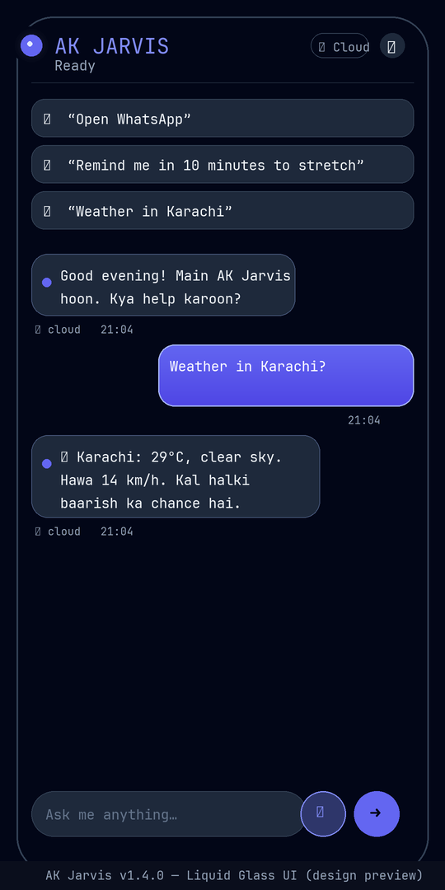

# 🤖 AK Jarvis

> **Your personal AI assistant for Android — talk to it in English, اردو or Roman Urdu, and it chats, answers, reminds, controls your phone and looks things up on the web.**

A native Android AI assistant with a hybrid **Cloud + Offline** architecture, built with Kotlin and Jetpack Compose. 100% free tools and free-tier APIs — no subscriptions, no ads, no tracking.

`Android 8.0+` · `Kotlin 2.0` · `Jetpack Compose` · `Room` · `DataStore` · `56 unit tests` · `APK in /releases`



*Design: "Liquid Glass" Slate + Indigo system, adapted from the [AbuZar-Ansarii/Jarvis](https://github.com/AbuZar-Ansarii/Jarvis) app. Preview above is a design mockup; the Iron Man theme is still available in Settings.*

| | |
|---|---|
| **Platform** | Android 8.0+ (API 26), optimized for 6 GB RAM devices |
| **Language** | Kotlin 2.0, Jetpack Compose (Material 3) |
| **AI** | Cloud: Gemini, Claude (Anthropic), Groq, OpenRouter, Z.ai GLM, or any custom OpenAI-compatible endpoint · Offline: rule-based engine that keeps device commands working with zero network |
| **Voice** | Android `SpeechRecognizer` (input) + `TextToSpeech` (output) |
| **Languages** | English, Urdu (اردو), Roman Urdu |
| **Storage** | Room database + DataStore — all data stays on the device |

## Features

- 💬 **AI chat assistant** with persistent history (Room)
- 🎙 **Voice input & spoken replies** (push-to-talk mic button)
- 🌐 **Urdu, Roman Urdu and English** — chat, commands, and replies
- 👂 **Optional wake word** ("Jarvis…") via a foreground service you explicitly enable
- 🚀 **App launching** by voice ("open WhatsApp" / "kholo youtube")
- ⚙️ **Settings shortcuts** (Wi-Fi, Bluetooth, battery, display, volume, airplane mode…)
- 🔔 **Notification reading** — only after you explicitly grant Notification Listener access
- ⏰ **Task reminders** with exact alarms + reboot-safe rescheduling
- 📝 **Notes & task management** with a dedicated screen
- 🔍 **Web search** commands
- 📁 **File access** only through the system file picker (Storage Access Framework)
- 🎭 **Customizable personality** — name, style (professional / friendly / funny), custom instructions
- 🌗 **Dark & light themes** (plus system default)
- 🔦 **Device tools by voice** — flashlight, volume up/down/mute, battery status, share, copy to clipboard
- 🧠 **Assistant memory** — say "remember…" / "yaad rakho…" and facts are stored on-device and injected into AI replies (view/clear in Settings)
- 🎙 **Hands-free follow-up** — after a spoken reply the mic stays open for 7 seconds so you can continue naturally
- 🌐 **30+ free web skills** — weather & 5-day forecast, air quality, sunrise/sunset, namaz times, cricket scores, currency & crypto rates, dictionary, translation, Wikipedia, research with sources, books, countries, holidays, jokes, quotes, cat/dog pictures, ISS tracker, GitHub/Stack Overflow lookup and more — all key-less free APIs
- 🧩 **Multi-commands** — "torch on karo aur volume up" runs both tasks in one message
- 🛑 **STOP button** — instantly cancels a running answer, speech or listening session
- 📇 **Contact-name calling** — "mama ko call karo" (opt-in Contacts permission; dialer opens, you confirm)
- 🦾 **Advanced mobile control** (opt-in accessibility) — "go back", "go home", "recent apps", "notification panel kholo", "scroll down", "tap on settings", "type hello", "screen parho"
- ⏸ **Media keys by voice** — "gaana chalao", "pause", "next song", "pichla track"
- 🖥 **Termux bridge** (optional) — forwards a safe allow-list of termux-api commands (battery status, toast, tts, vibrate…) to the Termux app
- 🔎 **Tavily deep search** — AI-optimized web search with sources (free key from tavily.com)
- 🌬 **Windy point forecasts** — wind/temp/precipitation for any city (free key from windy.com)
- 📍 **Nearby places (OpenStreetMap)** — "qareeb restaurant", "nearby atm" via free Overpass API, upgraded geocoding with Geoapify (free key)
- 🏭 **Iron Man theme** — hot-rod red & gold dark mode, plus dark/light/system
- ⬆ **In-app update checker** — reads update.json from this repo and tells you when a new version is out
- 🛡 **Privacy-first**: no analytics, no tracking, API keys stay on-device and out of backups

## Architecture

```
app/src/main/java/com/akjarvis/app/
├── AKJarvisApp.kt            # Application + DI init
├── MainActivity.kt           # Single activity, Compose navigation
├── di/ServiceLocator.kt      # Manual dependency graph
├── ai/                       # AI logic (independent of UI)
│   ├── AiEngine.kt           # Common engine interface
│   ├── CloudEngine.kt        # OpenAI-compatible cloud client (Retrofit + kotlinx-serialization)
│   ├── OfflineEngine.kt      # Rule-based offline fallback
│   ├── AiRouter.kt           # Cloud → offline graceful degradation
│   └── CloudDtos.kt
├── data/
│   ├── db/                   # Room: chat messages, notes, reminders
│   ├── prefs/                # DataStore settings (theme, language, API key…)
│   └── repo/                 # Repositories
├── device/                   # Android system integration
│   ├── AppLauncher.kt        # App list + fuzzy launch
│   ├── DeviceActionExecutor.kt # Executes commands, safety rules
│   ├── NotificationListener.kt # Opt-in notification reading
│   ├── AutomationService.kt  # Opt-in accessibility: back/home/tap/type/scroll/read
│   ├── TermuxBridge.kt      # Safe allow-listed Termux:API bridge
│   ├── Reminders.kt          # AlarmManager + receivers
│   └── FileManager.kt        # SAF helpers
├── domain/
│   ├── IntentRouter.kt       # EN / Roman Urdu / Urdu command parser
│   └── model/                # Pure domain models
├── voice/
│   ├── SpeechInputManager.kt # SpeechRecognizer wrapper
│   ├── TtsManager.kt         # TextToSpeech wrapper
│   ├── TtsSingleton.kt
│   └── WakeWordService.kt    # Optional foreground wake-word service
└── ui/
    ├── theme/                # Dark/light futuristic theme
    ├── components/           # Animated orb, message bubbles, voice indicator
    ├── chat/                 # Chat screen + ViewModel
    ├── settings/             # Settings screen + ViewModel
    ├── tasks/                # Notes & reminders screen + ViewModel
    └── permissions/          # Permission management screen
```

**Layering:** `ui → domain/ai/data → device`. The UI never talks to Android system services directly; AI engines never touch the UI.

## Quick start (build in Android Studio)

1. Install [Android Studio](https://developer.android.com/studio) (Koala or newer).
2. `File → Open…` and select this `AKJarvis` folder.
3. Let Gradle sync (it downloads AGP 8.5.2, Kotlin 2.0.20 and libraries automatically).
4. Press **Run** ▶ on your device or emulator (minSdk 26).

Or from the command line — see [docs/BUILDING.md](docs/BUILDING.md).

## Configure the AI

1. Open **AK Jarvis → Settings → AI provider** and pick one:

   | Provider | Default base URL | Default model | Cost |
   |---|---|---|---|
   | Z.ai (GLM) | `https://api.z.ai/api/paas/v4/` | `glm-4.5-flash` | Free tier |
   | Google Gemini | `https://generativelanguage.googleapis.com/v1beta/openai/` | `gemini-2.0-flash` | Free tier (AI Studio key) |
   | Groq | `https://api.groq.com/openai/v1/` | `llama-3.3-70b-versatile` | Free tier |
   | OpenRouter | `https://openrouter.ai/api/v1/` | `meta-llama/llama-3.3-70b-instruct:free` | `:free` models are free |
   | OmniRouter | `https://omnirouters.com/v1/` | `auto` | Unified AI gateway — edit base URL/model to match your account |
   | Claude (Anthropic) | `https://api.anthropic.com/v1/` | `claude-3-5-haiku-latest` | Paid API |
   | Custom | your endpoint | your model | Any OpenAI-compatible API |

2. Get a key from that provider's console, paste it in **Cloud AI configuration**. Optional free keys for extra skills: [CricAPI](https://cricapi.com) (cricket), [Tavily](https://tavily.com) (deep search), [Windy](https://www.windy.com/api) (forecasts), [Geoapify](https://www.geoapify.com) (places) — all in Settings. Nearby places and 30+ other web skills work with **no key at all** (OpenStreetMap/Overpass).
3. Base URL and model are pre-filled per provider but always editable (model IDs change over time — update them here without reinstalling).
4. Done — OpenAI-compatible providers use `{base-url}chat/completions`; Claude uses the native `messages` API.

Without a key the app stays fully usable in **Offline Mode** (device commands + basic conversation).

## Security model

See [docs/PERMISSIONS.md](docs/PERMISSIONS.md) for every permission and why it exists, and [docs/LIMITATIONS.md](docs/LIMITATIONS.md) for known constraints. Summary of hard rules baked into the code:

- Microphone is used **only** during an explicit listening session or the opt-in wake-word service.
- Calls/SMS commands only **open the dialer/messaging app** — nothing is sent without you pressing send.
- No passwords/OTPs are ever requested, stored or transmitted.
- Notification reading requires the separate, revocable Notification Listener access.
- The API key is stored in DataStore and excluded from cloud backups.

## License

For personal use. GLM model responses are generated by the provider you configure.
